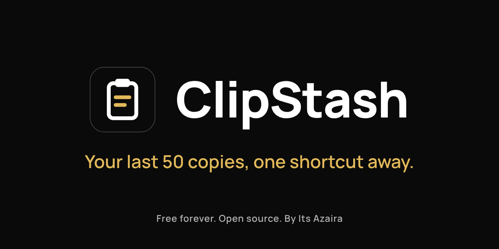

<p align="center">
  
</p>

# ClipStash

**Your last 50 copies, one shortcut away.** A tiny, free clipboard keeper for Windows and Mac, by [Its Azaira](https://itsazaira.com).

## What it does

ClipStash sits quietly in your system tray (Windows) or menu bar (Mac) and saves the last 50 bits of text you copy. Press **Ctrl Shift V** (Windows) or **Cmd Shift V** (Mac), click any item, and it pastes straight into the app you were using.

No account, no internet, no tracking. A small download (under 10 MB).

## Screenshots

_Coming soon._

<!-- Add images to docs/screenshots/ and link them here, for example:

-->

## Install

Download the latest installer from the [Releases page](https://github.com/itsazaira/clipstash/releases/latest).

ClipStash is free and not code signed yet, so your computer shows a warning the first time. That is expected.

### Windows

1. Download [`ClipStash-Windows-Setup.exe`](https://github.com/itsazaira/clipstash/releases/latest/download/ClipStash-Windows-Setup.exe) and open it.
2. If you see "Windows protected your PC", click **More info**, then **Run anyway**.
3. ClipStash starts in the system tray (bottom right, you may need to click the ^ arrow).

### Mac (Intel and Apple silicon)

1. Download [`ClipStash-Mac-Universal.dmg`](https://github.com/itsazaira/clipstash/releases/latest/download/ClipStash-Mac-Universal.dmg), open it and drag **ClipStash** into **Applications**.
2. The first time, **right click** ClipStash in Applications and choose **Open**, then **Open** again.
   On macOS 15 (Sequoia) or later, if it is still blocked: open **System Settings → Privacy & Security**, scroll down and click **Open Anyway**.
3. ClipStash appears in the menu bar at the top of the screen.
4. The first time you pick an item, ClipStash asks for **Accessibility** access so it can press Cmd V for you. Follow the short screen it shows. Until then, your item is still copied, so you can press Cmd V yourself.

## Features

- Saves new copied text automatically, newest first, with no repeated copies back to back
- Choose how many copies to keep: 10, 20, 50 or 100 (50 by default)
- One global shortcut to open and close: **Ctrl Shift V** on Windows, **Cmd Shift V** on Mac
- Search box on top, each item shows its first 2 lines and when you copied it
- Click an item (or use the arrow keys and Enter) and it pastes into the app you were just using. Opened from the tray or taskbar, a click copies the item so you can paste it anywhere
- Pin an item so it is always kept, unpin any time
- Pause recording, and Clear all (pinned items are kept)
- Light, dark or follow your system
- Lives in the system tray or menu bar, with Open, Pause and Quit. Shows on the taskbar while open, and you can drag it anywhere
- Starts automatically when your computer starts (on by default, change it in Settings)
- Skips copies that apps like password managers mark as private (Windows)

## Privacy

**Everything stays on your device.** ClipStash makes no network calls of any kind. There is no account, no server and no analytics. Your history is a single file in your app data folder:

- Windows: `%APPDATA%\com.itsazaira.clipstash\history.json`
- Mac: `~/Library/Application Support/com.itsazaira.clipstash/history.json`

## Build it yourself

You need [Node.js 20+](https://nodejs.org) and [Rust](https://rustup.rs), plus the [Tauri prerequisites](https://tauri.app/start/prerequisites/) for your system.

```bash
npm install
npm run tauri dev     # run with live reload
npm run tauri build   # make an installer
```

## Links

- Website: https://itsazaira.com
- GitHub: https://github.com/itsazaira/clipstash
- Instagram: https://www.instagram.com/itsazaira/
- LinkedIn: https://www.linkedin.com/company/itsazaira
- [Support](mailto:hello@itsazaira.com)

Free forever. Open source, [MIT licence](LICENSE).

**Its Azaira**, Ideas, built from A to Z.
