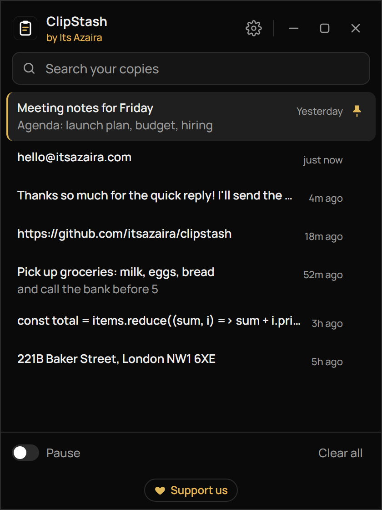
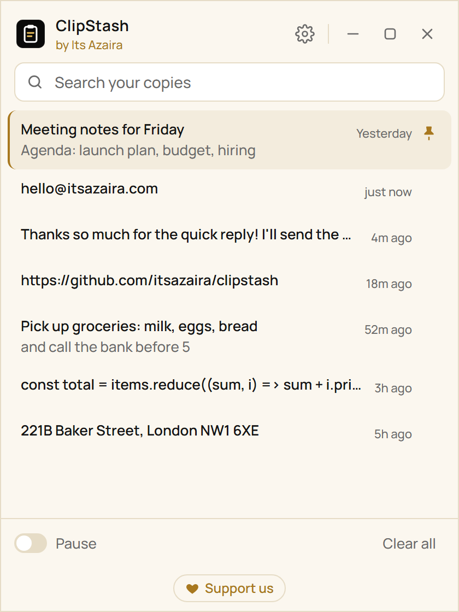
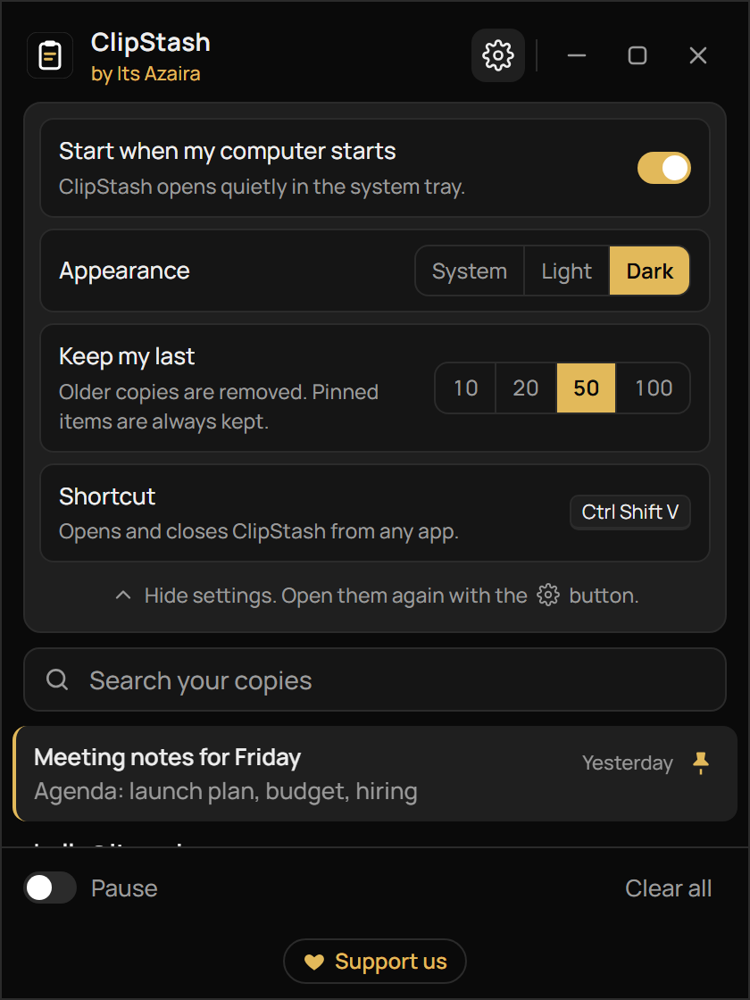
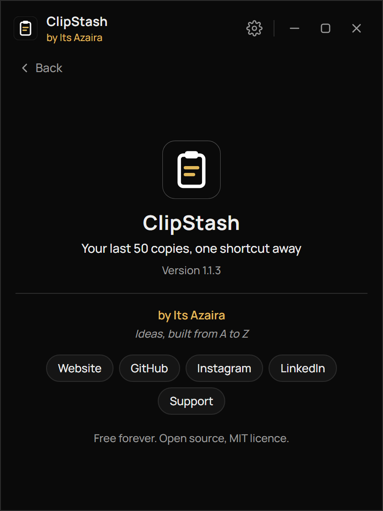

<p align="center">
  
</p>

# ClipStash

**Your last 50 copies, one shortcut away.** A tiny, free clipboard keeper for Windows and Mac, by [Its Azaira](https://itsazaira.com).

[Download for Windows](https://github.com/itsazaira/clipstash/releases/latest/download/ClipStash-Windows-Setup.exe) · [Download for Mac](https://github.com/itsazaira/clipstash/releases/latest/download/ClipStash-Mac-Universal.dmg) · [All releases](https://github.com/itsazaira/clipstash/releases)

## What it does

ClipStash sits quietly in your system tray (Windows) or menu bar (Mac) and remembers the text you copy: your last 50 copies by default, or 10, 20 or 100 if you prefer. Press **Ctrl Shift V** (Windows) or **Cmd Shift V** (Mac), click any item, and it pastes straight into the app you were using.

No account, no internet, no tracking. A small download (under 5 MB).

## Screenshots

<p align="center">
  
  
</p>
<p align="center">
  
  
</p>

## Install

ClipStash is free and not code signed yet, so your computer shows a warning the first time. That is expected.

### Windows 10 and 11

1. Download [`ClipStash-Windows-Setup.exe`](https://github.com/itsazaira/clipstash/releases/latest/download/ClipStash-Windows-Setup.exe) and open it.
2. If you see "Windows protected your PC", click **More info**, then **Run anyway**.
3. ClipStash starts in the system tray (bottom right; you may need to click the ^ arrow).

### Mac (macOS 10.15 or later, Intel and Apple silicon)

1. Download [`ClipStash-Mac-Universal.dmg`](https://github.com/itsazaira/clipstash/releases/latest/download/ClipStash-Mac-Universal.dmg), open it and drag **ClipStash** into **Applications**.
2. The first time, **right click** ClipStash in Applications and choose **Open**, then **Open** again.
   On macOS 15 (Sequoia) or later, if it is still blocked: open **System Settings → Privacy & Security**, scroll down and click **Open Anyway**.
3. ClipStash appears in the menu bar at the top of the screen.
4. The first time you pick an item, ClipStash asks for **Accessibility** access so it can press Cmd V for you. Follow the short screen it shows. Until then, your item is still copied, so you can press Cmd V yourself.

### Updating

Download the latest installer and run it over your current version. From version 1.1.3 on, your history is kept when you update.

## How to use it

- **Copy as usual.** ClipStash saves each new piece of text you copy, newest first.
- **Press Ctrl Shift V** (Cmd Shift V on Mac) in any app, then click an item, or use the arrow keys and Enter. It pastes into the app you were just in.
- **Opened from the tray or taskbar instead?** There is no app to paste into, so clicking an item copies it. Press Ctrl V (Cmd V) wherever you want it.
- **Search** with the box at the top. Each item shows its first two lines and when you copied it.
- **Pin** an item with the pin icon to keep it forever, above everything else. Click again to unpin.
- **Pause** stops saving new copies until you turn it off. **Clear all** removes everything except pinned items.
- **The window** stays open until you close it. Drag the header to move it, drag an edge to resize, and use the buttons at the top right to minimize, maximize or close. Closing hides it to the tray; ClipStash keeps running.
- **Settings** (the gear) opens a pane at the top: start when your computer starts, System / Light / Dark appearance, how many copies to keep (10, 20, 50 or 100), and the shortcut. Click the gear again to hide it.
- **Support us** at the bottom opens the About page, with all our links.
- **The tray icon** (menu bar on Mac) has Open ClipStash, Pause recording and Quit.

## Features

- Saves copied text automatically, newest first, with no repeated copies back to back
- Keeps your last 10, 20, 50 or 100 copies (50 by default); pinned items are always kept
- One global shortcut: **Ctrl Shift V** on Windows, **Cmd Shift V** on Mac
- Search, pin, pause and clear
- Pastes into the app you were using, or copies when there is no app to paste into
- Light, dark or follow your system
- A normal window: move, resize, minimize, maximize; shows on the taskbar while open
- Lives in the system tray or menu bar; starts when your computer starts (on by default)
- Skips copies that apps like password managers mark as private (Windows)
- Text only for now: copied images and files are not saved

## Privacy

**Everything stays on your device.** ClipStash makes no network calls of any kind. There is no account, no server and no analytics. Your history is a single file on your computer:

- Windows: `%APPDATA%\ClipStash\history.json`
- Mac: `~/Library/Application Support/ClipStash/history.json`

Uninstalling ClipStash leaves this file in place; delete the folder if you want your history gone too.

## Uninstall

- **Windows:** Settings → Apps → Installed apps → ClipStash → Uninstall.
- **Mac:** turn off **Start when my computer starts** in Settings, quit ClipStash from the menu bar, then drag it from Applications to the Bin.

## Build it yourself

You need [Node.js 20+](https://nodejs.org) and [Rust](https://rustup.rs), plus the [Tauri prerequisites](https://tauri.app/start/prerequisites/) for your system.

```bash
npm install
npm run tauri dev     # run with live reload
npm run tauri build   # make an installer
```

Releases are built by GitHub Actions: pushing a tag like `v1.2.0` builds the Windows and Mac installers and publishes them to a GitHub Release.

## Links

- Website: https://itsazaira.com
- GitHub: https://github.com/itsazaira/clipstash
- Instagram: https://www.instagram.com/itsazaira/
- LinkedIn: https://www.linkedin.com/company/itsazaira
- [Support](mailto:hello@itsazaira.com)

Free forever. Open source, [MIT licence](LICENSE).

**Its Azaira**, Ideas, built from A to Z.
